# Tri Coach

A personal endurance-coaching app built around a single question I ask every
morning before training: *given how I actually slept and recovered, what should
I do today — and does it still fit the rest of my life?*

It pulls live Garmin recovery and training data, models readiness, runs a
periodized plan toward a race, and keeps two AI agents in the loop: a
conversational coach that can reprogram the plan, and a natural-language
calendar assistant that schedules workouts around a real calendar with two-way
Google sync. It runs as an installable PWA that is built to feel like an app on
a phone rather than a web page: large titles that collapse into a glass bar, a
floating tab capsule, pull to refresh. Behind everything a slow greyscale field
moves like water, wind or cloud, following the sport of the day's session. The
interface is monochrome on purpose (ink on paper, no accent colours, no emoji),
and swim, bike and run are told apart by line texture instead of colour. It is deployed on Fly.io. Built solo,
with Claude Code and
OpenAI Codex doing most of the typing — see
[Built with AI, deliberately](#built-with-ai-deliberately).

The active goal is a persisted event profile rather than a compile-time race.
Athlete constants, universal coaching rules, and the current event remain
separate; an explicit switch can move the same coach between marathon,
triathlon, cycling, lifting, or another fully specified goal without recovering
the choice from chat history.

> Status: actively used daily by one athlete (me). It's a real tool, not a demo —
> which is why the hosted instance is access-gated rather than a public link.

---

## Why I built it

I tried a lot of the obvious things first — Garmin Connect Premium, WHOOP, a
couple of paid triathlon coaching plans. They're all good at what they measure.
What none of them handled was *my actual life*.

Every one of them assumed my weeks were identical: same wake-up, same free
evenings, same willingness to be in the pool at 5am on a Tuesday. But an old
friend asks if I want to grab beers, I'm out until 2am, and the 5am session was
never happening. A rigid plan responds to that by turning the rest of the week
into a guilt trip and a pile of "missed" workouts.

I wanted the opposite: **a plan as fluid as the life it has to fit into.** One
that re-plans week to week around real school hours and real commitments, moves a
session instead of writing it off, tells me when I'm actually recovered enough to
go hard — and, crucially, *doesn't quietly decide for me*. An early version of
this app silently swapped a key VO2 session for a recovery spin because my HRV
looked low; I saw the easy session, went back to sleep, and later found the
numbers hadn't been that bad. That's why readiness in here is **advice, not a
veto** — the athlete makes the call.

So the design goals came out of frustration, not features:

- **The plan bends, the athlete doesn't get bullied.** Low recovery surfaces a
  warning and an easier option; it never rewrites your day behind your back.
- **Life is a first-class input.** Your real calendar drives scheduling —
  workouts land around school (08:00–12:40, every day) and route around whatever
  else is on it.
- **Talk to it like a person.** "Move my bike to Thursday morning", "I'm at the
  driving range tonight", "only 45 min today, legs are cooked."
- **Every week is allowed to look different.** The plan is re-shaped around
  travel, illness, a big work week, or a late night — without losing the arc that
  gets you to the start line.

---

## The six tabs

### Home
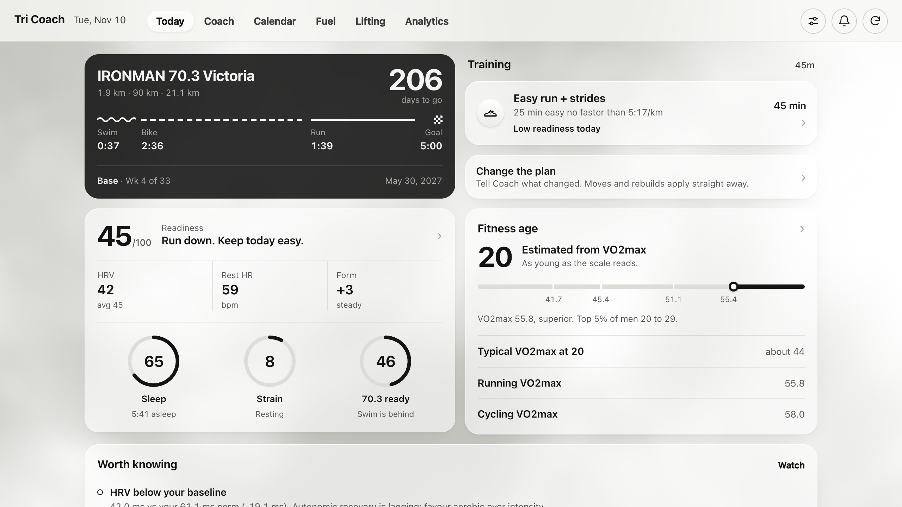

The top of Home is a race bib: the event, the days left, the goal, and the
course drawn as one line from start to finish. The line is split into swim,
bike and run in proportion to the goal splits (0:37, 2:36 and 1:39 for a 5:00
finish), each in its own texture, so the picture changes the day the goal does.
Today's session sits directly under it, because that is what the app is opened
for.

Below that the readiness score reads out of Garmin: HRV against your own rolling
baseline, resting HR and form (TSB), with a plain-English verdict rather than a
number to interpret, and three rings for sleep, strain and how ready you are for
the event. Every one of them opens a full breakdown. Then plain-language signals
and the five most recent activities. Training load lives in Analytics, where
there is enough room to explain it properly instead of compressing it into
another Home card.

<p>
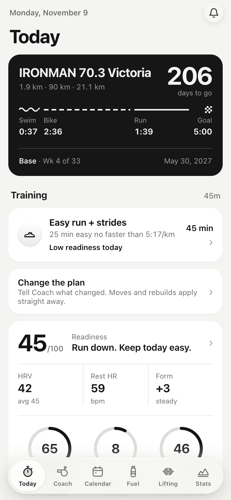
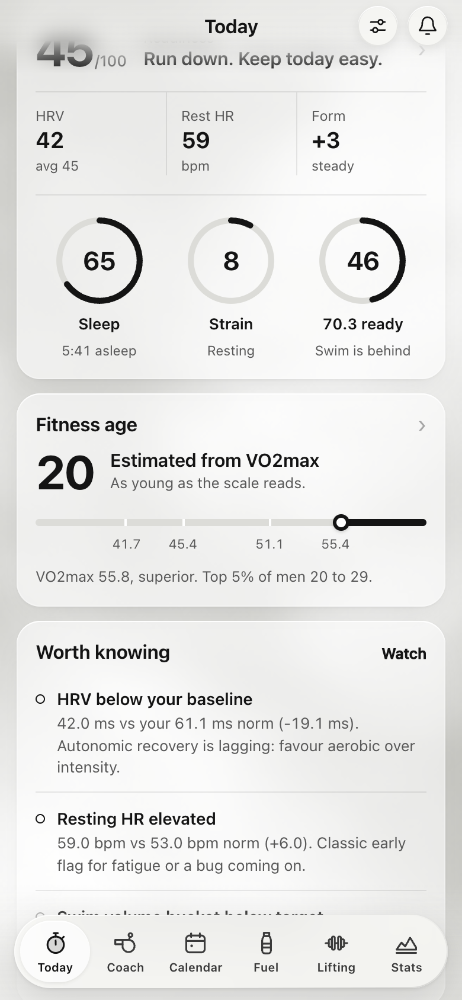
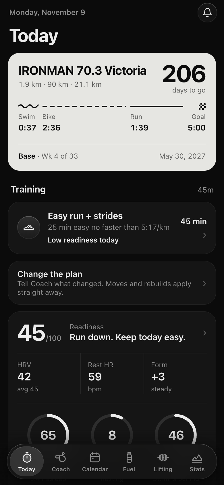
</p>

**Fitness age.** Garmin gives a fitness age from 20 and I am younger than that,
so its API answers with a reason and no number. The card shows Garmin's figure when there
is one. Until then it shows an estimate and says so: the age at which a typical
person of the same sex has this VO2max, read off the Cooper Institute bands that
Garmin prints in its own watch manuals. That table starts at 20, so 20 is the
youngest the estimate can read, and a VO2max above the typical 20 year old's
lands on that floor and is labelled as the floor rather than extrapolated into a
nonsense age. The same card places VO2max on the band scale (55.8 is the top 5%
of men 20 to 29).

Readiness advises; it never overrides. If recovery is poor the app says so and
offers an easier alternative when you push the session to your watch, but it will
not silently swap your training out from under you. That line was drawn after an
early version quietly downgraded a key workout and cost a good training day.

### Coach
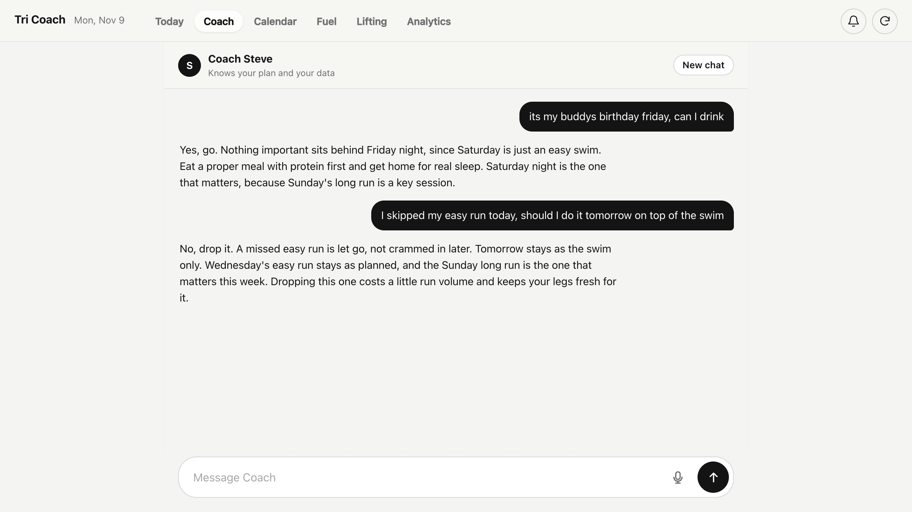

*The replies in these screenshots are real answers from the coach model to test
questions against a sample plan. They are not my own conversation.*

A conversational coach (Claude) with the full picture: Garmin data, the plan, the
week's load, prior coaching turns, and your own stated constraints. It is direct
by design and cannot invent numbers — a missing metric is reported as missing.

**A reply that changes the plan changes the plan.** There is no Accept tap. When
Steve's answer moves, swaps, eases or rebuilds sessions, the backend applies the
change as soon as the reply is finished and the chat shows a "Plan updated" card
listing every day that moved, with one Undo that restores all of them (time,
lift and separate sessions included). If a reply says it changed something but
forgot the machine-readable block, the backend asks once more for just the
block. A change that fails validation falls back to a manual card so nothing is
silently lost. Replies lead with the call in a sentence or two; stats appear only
when asked for.

**Strict where it matters, easy where it doesn't.** Ask about a night out and
the call is worked out in code before the model writes a word, from three facts:
the days left to the race, the phase of the block, and what is planned the next
morning. There are five calls. Inside 14 days of the race it is a hard no, said
bluntly and without a lecture. The night before a key session it depends on the
block: once training is past base it is "not this night", with the nearest clear
nights offered instead, and early in the block it is a yes and the session
moves. On any other night it is a plain yes, with no guilt and no drink count.
After the race it is go and celebrate. The model writes the sentence; it does
not decide the call. The check only knows the calendar, so a run-down readiness
score or "I'm sick" still means bed whatever the verdict says.

When a night is named but cannot be placed on the calendar ("next month", "for
my birthday", "race weekend"), there is no verdict at all: the coach asks which
night. No date cue means tonight; a date cue that cannot be resolved never
quietly becomes tonight. Known limits: an event with no date ("at the wedding")
is judged as tonight, and "Monday night after the race" returns both race night
and the Monday.

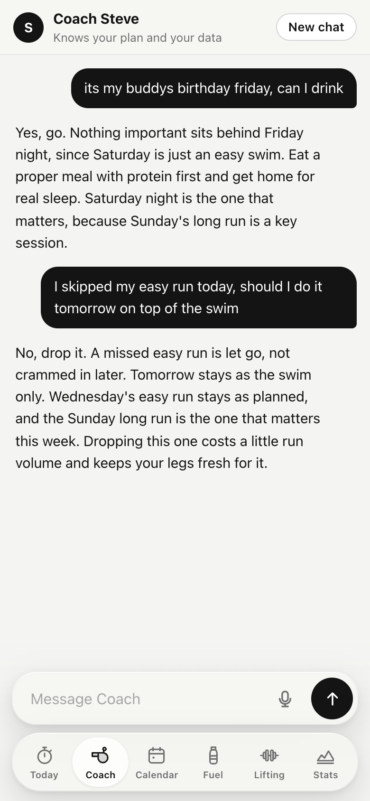

**A reviewed reference, not recall.** Steve carries a short reference on how the
sport is trained and raced at the top: intensity distribution, swim, bike, run,
bricks, fuelling, heat, supplements, sleep, alcohol, taper, race execution,
recovery and strength. Each of the fourteen topics says what the pros do, what
the research supports and how strong that evidence is, how it applies to this
athlete, and what not to copy. A pro's principle scales to an age-grouper and a
pro's numbers do not, so nothing in it is a prescription and the athlete's own
rules outrank every line. Only the topics a question touches are sent, three at
most. It was last reviewed in November 2026.

<details>
<summary>Sources for the reference</summary>

- Intensity: [TrainingPeaks on the Norwegian method](https://www.trainingpeaks.com/coach-blog/norwegian-training-method-world-champion-triathletes/),
  [Triathlete](https://www.triathlete.com/training/how-to-train-like-a-norwegian-without-the-blood),
  [TRI247](https://www.tri247.com/triathlon-news/elite/lionel-sanders-turns-to-norwegian-method-after-struggles)
- Swim: [TrainingPeaks on adult-learned swimmers](https://www.trainingpeaks.com/coach-blog/four-principles-for-coaching-adult-learned-swimmers/),
  [220 Triathlon](https://www.220triathlon.com/training/swim-training/how-to-set-your-swim-training-benchmark),
  [Purple Patch](https://purplepatchfitness.com/freetrainingtips/getting-faster-triathlon-swim)
- Durability: [Athletica](https://athletica.ai/unlocking-endurance-durability-the-missing-link-in-endurance-performance/),
  [Knowledge is Watt](https://knowledgeiswatt.substack.com/p/82-how-to-train-durability)
- Fuelling: [Slowtwitch](https://slowtwitch.com/triathlon/why-pros-do-high-carb-better-and-how-you-can-too/),
  Precision Fuel & Hydration case studies
  ([Løvseth](https://www.precisionhydration.com/athletes/case-studies/triathlon/solveig-lovseth/28-03-2026/),
  [Geens](https://www.precisionhydration.com/athletes/case-studies/triathlon/jelle-geens/09-11-2025/)),
  [TRI247](https://www.tri247.com/triathlon-health/nutrition/how-to-fuel-for-a-triathlon)
- Heat: [Heat suit training and hemoglobin mass](https://zendy.io/title/10.1111/sms.14156),
  [Mechanisms of haemoglobin mass expansion following heat stress](https://www.fisiologiadelejercicio.com/wp-content/uploads/2025/08/Mechanisms-of-haemoglobin-mass-expansion-following-heat-stress-1.pdf),
  [Freespeed](https://freespeed.substack.com/p/heat-training-for-triathletes-the)
- Supplements: [BikeRadar on sodium bicarbonate](https://www.bikeradar.com/advice/nutrition/sodium-bicarbonate-cycling/),
  [World Athletics](https://worldathletics.org/organisation/news/nutrition-study-sodium-bicarbonate-carbohydrate-co-ingestion)
- Race pacing: [Best Bike Split](https://www.bestbikesplit.com/blog/pacing-70-3-bike-leg-intensity-factor-tss),
  [Triathlon Magazine Canada](https://triathlonmagazine.ca/racing/how-to-pace-a-70-3-or-ironman-triathlon/),
  [Pacing strategies during athletic competition](https://ro.ecu.edu.au/ecuworks/877)
- Alcohol: [Alcohol, Athletic Performance and Recovery](https://www.doi.org/10.3390/NU2080781),
  [alcohol and overnight heart-rate variability](https://www.pubmed.gov/29549064/),
  [WHOOP](https://www.whoop.com/de/en/thelocker/alcohol-and-the-collegiate-whoop-athlete)
- Taper: [Effects of tapering on performance in endurance athletes](https://pubmed.ncbi.nlm.nih.gov/37163550/),
  [Bosquet's taper meta-analysis](https://coachsci.sdsu.edu/csa/vol131/bosquet.htm)
- Sleep: [AASM](https://aasm.org/chronic-sleep-restriction-negatively-affects-athletic-performance/),
  [GSSI Sports Science Exchange 167](https://www.gssiweb.org/en/sports-science-exchange/Article/sse-167-sleep-and-athletes)
- Also read: doi:[10.1007/s00421-024-05567-3](https://link.springer.com/article/10.1007/s00421-024-05567-3),
  doi:[10.3389/fphys.2022.835705](https://www.frontiersin.org/articles/10.3389/fphys.2022.835705/full),
  doi:[10.1007/s40279-014-0244-0](https://link.springer.com/10.1007/s40279-014-0244-0)

</details>

The coach runs on Claude Sonnet 5.5. If its safety classifier declines a request
(`stop_reason: "refusal"`), the request is retried once on Sonnet 5 so an
ordinary training question never dead-ends.

Steve now runs against one shared coaching contract instead of scattered prompt
fragments. It fixes the athlete constraints, source-labelled fueling conversions,
TSB rules and lifting behavior separately from the active event profile. Ordinary
questions cannot silently change sports or carry course assumptions into another
event: only an exact `switch to [event]` command reaches the mode gate, and an
unknown event leaves TRIATHLON active until a complete replacement profile exists.
Every stored and Coach-proposed plan carries an explicit projected race-day TSB
target. Missing or out-of-range model values normalize to +10 before the draft
write, while edited drafts and API clients still face the strict +5 to +15
boundary. A current-day form value therefore cannot discard an otherwise valid
generated week or be mistaken for the eventual taper objective.

Body mass is live rather than frozen. Coach and Nutrition read the newest dated Garmin
weight entry, including its date and the grams-to-kilograms arithmetic, and label
it self-reported via Garmin because the athlete maintains it there. If Garmin has
no dated reading, they explicitly fall back to the
self-reported 86 kg constant instead of treating an aggregate average as current.

The visible chat opens as a clean conversation every time the app launches or
resumes, so there is no transcript to scroll through. That is presentation only:
Steve keeps a private server-side window of previous turns plus dated, durable
memories such as availability, injuries, travel and equipment constraints. Chat,
durable memory, plan rows and unread Coach updates are namespaced to the active
event profile, so a future switch cannot reintroduce old course or fueling
assumptions. The result is a fresh screen without an amnesiac coach. Automatic briefs are
event-driven rather than launch-driven — a new sleep/recovery day, synced workout
or completion log can trigger one; simply reopening the app cannot. Those event
briefs now wait in a durable Coach inbox: an unread badge appears on both the
desktop and mobile Coach tabs, and the message is acknowledged only after that tab
is opened. It therefore survives a reload or switching between phone and desktop.

The visible conversation is also cached on the device for five minutes. A quick
lock-screen, app switch, PWA suspension or computer sleep restores the same chat,
opened at the latest message; after the window expires, the UI returns to a clean
chat while Steve's longer private coaching context remains intact.

The configured A-race finish is its own one-time event. Once Garmin syncs the
race-day swim, bike and run, Steve celebrates the result before attempting any
critique or next-block planning, using the recorded leg data so the message is
specific to the actual finish. The Coach screen marks it with one plain line and
then returns to its normal event-driven behavior.

While Steve works, the conversation shows three dots and a line saying what he is
doing: checking the latest training data, then drafting the reply and saving any
plan change. The finished reply appears once that change has been validated and
stored, so a half-written week is never on screen. The page follows new messages,
and a long answer stops with its first line at the top instead of jumping to its
last.
Long asks (a full strength block, a reshaped month) never come back cut off: thinking
and the visible reply share one output budget, so a reply that hits it is retried
with double the room (32K, 64K, then 128K tokens) and only the finished answer is shown.
The composer also has microphone dictation on browsers that expose the Web Speech
API. Interim words appear in the normal message box, and the athlete reviews and
sends the transcript explicitly; stopping dictation never auto-submits a coaching
request.

Availability is structured rather than left in one fragile chat turn. Statements
such as "classes are 8–1 next week", "the gym opens at 6:30", "I need 30 minutes
to shower", travel, and known late nights are stored as dated athlete-level
schedule facts. They survive a fresh Coach session and an event-mode change,
while live non-workout Google Calendar events are read into every planning turn as
busy-time facts. Coach receives the existing plan and calendar for the next 14
days, protects key goal-specific work before recovery-risk nights, and schedules a
safer following morning without claiming a hangover is certain.

Completed structured sessions are evaluated step by step. Garmin's recorded
ACTIVE interval boundaries are joined to the timestamped HR trace, so Steve sees
the duration-weighted average/max and exact minutes below, inside and above the
target for every work bout. The blended activity average is never used to grade
interval execution, because warm-up, recoveries and cool-down intentionally pull
it down. Explicit HR ranges are also encoded verbatim in future watch workouts so
the workout text and Garmin target cannot silently disagree.

Race questions are routed through a structured, page-linked digest of the supplied
2026 Vancouver Athlete Guide. Steve knows the exact check-in schedule, transitions,
course/cutoffs and bike/run aid-station locations and products, while explicitly
refusing to invent serving volumes or variants the guide does not specify.

It will reprogram any upcoming day, rebuild a whole week around a constraint,
log sessions you did off-plan, propose calendar events from a passing mention,
and decide on its own what is worth remembering (availability, niggles, travel)
versus what is just chatter. It also follows an explicit set of load rules: state
the TSB target, hold the race-day taper between +5 and +15, name the tradeoff
when cutting volume, give easy sessions a hard ceiling rather than a range, and
progress run volume with a weekly cap and a real long run rather than a step
change to hit a load number.
The standing three-day full-body split is preserved whenever Steve rebuilds a
training week and placed around the key sessions. Lifting prescriptions include exercise
order, sets, reps or duration, rest and effort while leaving unknown working
weights unknown, and taper automatically as the race approaches — moderate
inside three weeks, light inside two, nothing in the last two days. Strength
added that late does not arrive in time to help; the fatigue it costs arrives
immediately.

### Calendar
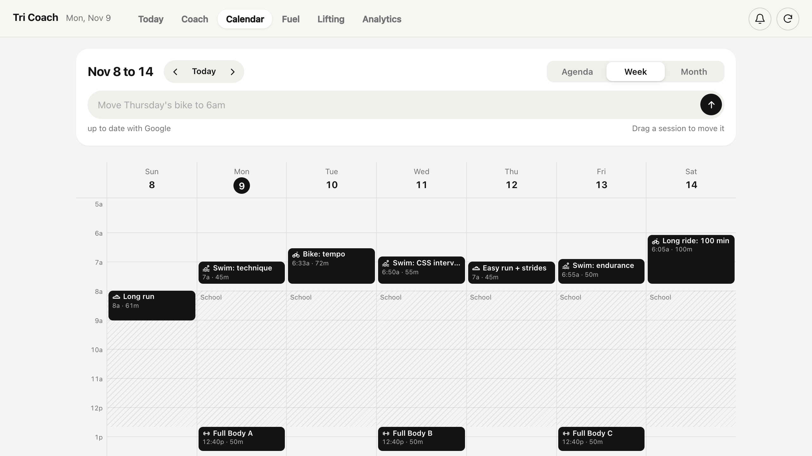

Training and life on one surface, synced two ways with Google Calendar. Agenda,
Week and Month views, with navigation back through previous weeks and months.
Workouts are written to Google as timed blocks, placed before school when they
fit and straight after it when they don't, and routed around whatever is already
booked. The week view shades the school block on every day.

On a phone the Month view is a grid of days with a small icon for each session,
and tapping a day lists what is on it underneath.

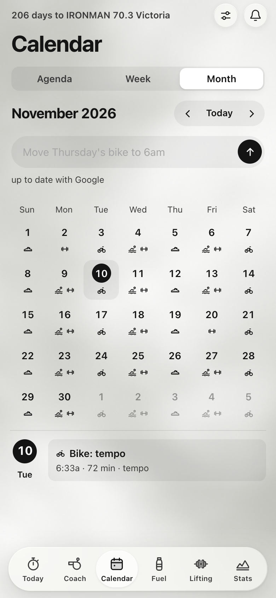

Drag a session to move it and tap it to open the full breakdown — every calendar
change pushes straight to Google. Edits you make *in* Google flow back on next
open, resolved most-recent-edit-wins. Calendar owns placement, not prescription:
workout duration and contents can only be changed through Coach Steve, so a drag
cannot accidentally rewrite the training plan. The command bar at the top takes
plain English: "move my bike to Thursday 6am", "swap Tuesday and Friday", "add
dentist Fri 2pm for 45 minutes". Timed personal events require an explicit start
and duration; the app asks instead of inventing a missing duration.

Cardio and lifting that share a date stay as two workout records, two duration
budgets, and two clickable cards. A `brick` is reserved for one continuous bike
session followed immediately by an explicit run leg; the presence of a second
workout on the date is never enough to infer a brick.

Coach-generated drafts can carry an explicit start time for both the primary
session and a separate same-day lift. Accepting the draft writes those positions
before Google reconciliation; when Coach leaves a time open, the default placer
still honors remembered busy/available windows, facility hours, and post-training
shower or commute buffers.

### Lifting
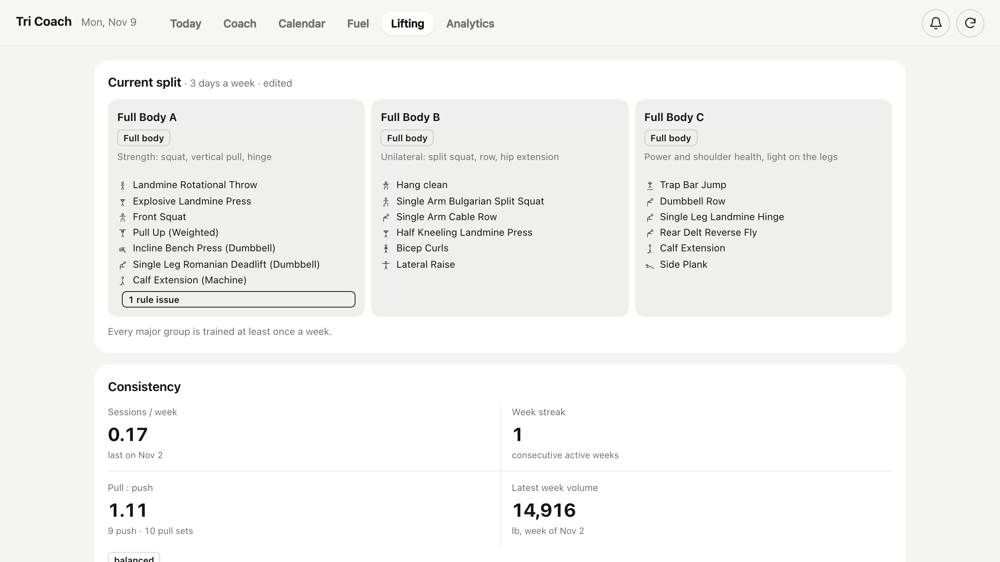

The current Full Body A / B / C split comes first and can be edited in place or
changed through Coach. A routine created in Hevy from a Coach card and named after
a split day ("Full Body A") replaces that day on the tab, and so does a routine
edited in Hevy itself (for example by saving a finished workout back to it): the
newer of the two wins. The calendar's upcoming lift days are regenerated to match. Every day the coach designs follows the athlete's shoulder defaults in
code (one press per session, triceps isolation allowed, no face pulls), and the
leg load falls through the week: heavy A on Monday after the long run, unilateral
B on Wednesday before the run quality day, light plyometric C on Friday before
the long ride, with no press at all. The 70.3 plan attaches these three lifts to
its swim days automatically and doses them by phase — heavy in base, held in
build, two-set maintenance once race-specific work starts, light in the taper. A changed day can be
sent to Hevy as a routine after explicit confirmation.

An exercise Hevy does not have is created there as a custom exercise during the
send. Hevy can accept that create and still answer with a reply the client cannot
read, so after any unusable reply the app re-reads Hevy's exercise list and uses
the exercise if it is now there. Only a create Hevy actually refused is reported,
with Hevy's reason.

The rest of the tab is evidence from completed Hevy workouts: recent sessions,
exercise volume and frequency, estimated strength records, progression trends,
muscle balance, consistency and stale-load calibration. Garmin strength
activities establish that lifting happened when Hevy was not logged, but Hevy
remains the source for exercises, sets and weights. Long lists show their first
five rows with a Show all control, so the tab opens short.

### Nutrition
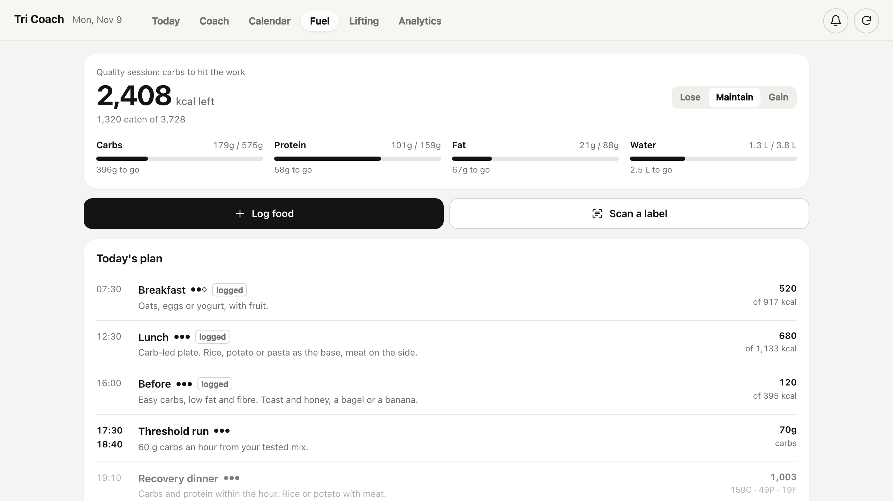

Modelled on what the paid trackers do well (MacroFactor's fast logging,
Cronometer's exactness, the timed carb-coded meal plans of athlete apps like
Fuelin), without their guesswork:

- **Calories left, then four bars.** One big number, and carbs, protein, fat and
  water against today's targets. The Lose / Maintain / Gain switch re-derives the
  targets, taking a deficit from fat and non-training carbohydrate while
  protecting protein.
- **Today's plan, timed around the session.** The day's targets are split into
  meals placed around the planned start time (an early session gets a pre-snack
  and a recovery breakfast; an evening one gets a carb-led lunch and a recovery
  dinner). Each meal has a one-to-three-dot carb code and a plain food idea;
  every column sums exactly to the daily target, and during-session carbs come
  from the fuelling plan. Logged food fills the matching meal.
- **One-tap repeat logging.** Every food logged is saved per serving. "My foods"
  logs ½×, 1×, 1.5× or 2× in one tap, with pinning and removal.
- **Label scan.** Photograph a nutrition panel; Claude reads it with a strict
  JSON schema and the values pre-fill the form for you to check. A scan is never
  logged on its own, and a photo that isn't a label is refused.
- **Water** with +250 / +500 / +750 and undo, against a target from body mass
  plus the session's sweat loss.
- **This week**: eaten against each day's target as it was at the time, with
  protein and carb hit counts. Targets are snapshotted daily, never back-filled.
- **Ask Chef Gordo** for a straight answer ("can I have pizza tonight?"), plus
  recipe search and a grocery list.

The rule underneath all of it: numbers are exact or absent. Values come from the
athlete or a printed label. Vague text or a plate photo leaves portions and
macros unknown and asks for the measured recipe or label instead of saving an
estimate, and the meal-plan food notes carry no portion numbers at all.

The part that matters is intra-session fuelling, which is built against
intestinal transport limits rather than a flat carb number. Glucose is capped at
60 g/h (SGLT1) and fructose at 30 g/h (GLUT5); above 60 g/h total the mix is held
at 2:1. The fixed kitchen factors are 12.5 g carbohydrate per tablespoon of
granulated sugar, 13 g per tablespoon of maple syrup, and 2,360 mg sodium per
teaspoon of table salt. Drinks use an exact scale-verified finished mass so the
6–8% concentration is checkable. Mass is never converted to volume by assuming
1 g/mL: the finished drink volume must be measured, and the separate plain-water
amount stays unknown until then. Brick and race totals use the bike duration
only, never the run or whole-event duration. Every plan carries its arithmetic,
labels each input source, and carries an abort protocol that introduces nothing
untested. The workout sheet shows only the part used on the day: carbs, fluid
and sodium per hour, what goes in each hour's bottle, and the session total. The
transport limits and the arithmetic stay in the payload for Coach.

Custom fueling questions use a shared audit contract in both Nutrition and Coach:
resolve the exact race/training leg, distinguish table-salt mass from sodium,
inventory every bottle/flask/gel, reconcile totals with hourly rates, then place
only those doses at the Athlete Guide's actual aid stations. Concentrate flasks are
evaluated with the water taken alongside them, and uncertain labels trigger a
focused question instead of a confident guess.

The deterministic recipe uses the athlete's own factors: 1 tsp salt = 2,360 mg
sodium, sugar = 12.5 g carbohydrate/tbsp, maple syrup = 13 g/tbsp split 50/50,
and each gel = 23 g carbohydrate plus 20 mg caffeine. Long-session mix arithmetic
shows glucose and fructose separately, finished-drink concentration by mass, and
the abort protocol. A race calculation will not misuse the 5:45 whole-event model
as a bike-leg duration; that missing input stays unknown until supplied.

Typing a food in plain words (for example "iced chai latte grande from Starbucks") logs a
ballpark: published values when the brand and size are known, typical values otherwise.
Those entries are marked as estimates in the log and counted separately in the day
payload, so measured and estimated intake stay distinguishable. Scan barcode takes one
photo: a barcode is read, check-digit validated and looked up in Open Food Facts, and a
nutrition panel is read as printed. Either way the values only prefill the form for
review before anything is saved.

Coach Steve also reads Garmin's daily calorie burn (total, active and resting) for the last seven finished days. Asked how much to eat, he quotes the measured average and a target worked out in code from that average and the lose, maintain or gain goal. Today's running total is labelled as partial and left out of the average.

### Analytics
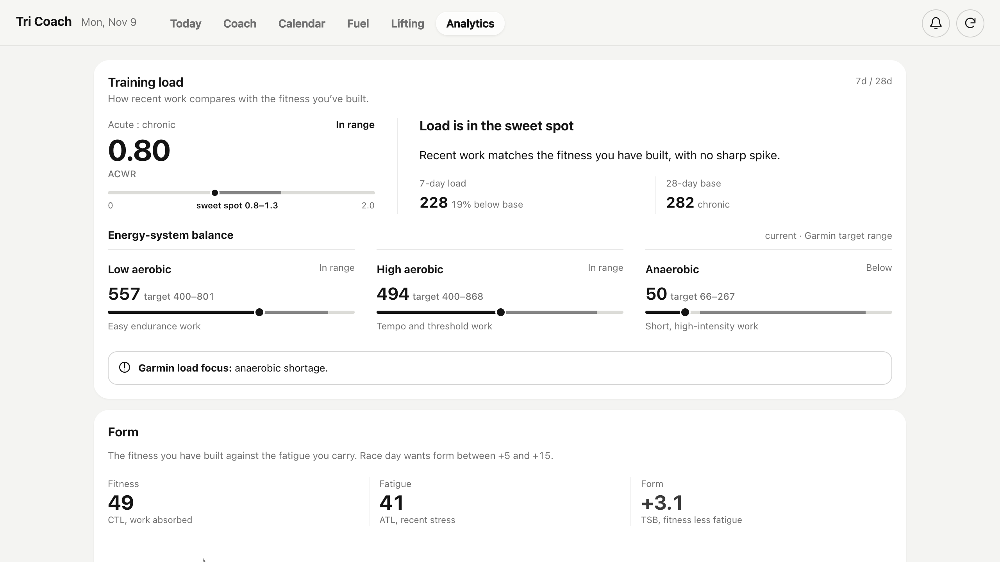

The top of Analytics is a training-load decision surface: acute:chronic ratio
with its 0.8–1.3 target band, seven-day load against the 28-day base, and separate
low-aerobic, high-aerobic and anaerobic cards that plot the current value against
Garmin's target range. Below that sit fitness, fatigue and form (CTL / ATL / TSB)
over 90 days, and a Training volume card: the last six Monday weeks, one row
each, the bar drawn in each sport's line texture. Tap a week for its breakdown;
six-week totals by sport sit underneath.

Training zones use the same visual hierarchy instead of a compressed text table:
Garmin LT HR, max HR and threshold pace lead into five progressive intensity
cards. Every card keeps run HR, bike HR and run pace visible — cycling zones sit
lower than running — and those exact values are what pushed workouts target on
the watch.

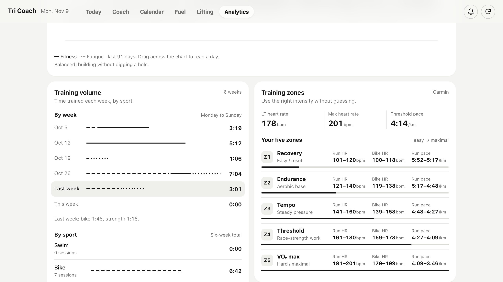

---

## Also

**Structured workouts to the watch.** Sessions push to Garmin as native
structured workouts with explicit bpm ranges and pace bands drawn from your own
zones, not bare zone numbers. Bike work is prescribed by heart rate — an
indoor FTP does not transfer to hilly outdoor riding — and watts appear only as a
secondary cue on explicitly indoor sessions. Easy runs carry a pace *ceiling*
rather than a range.

The watch runs what the card says, step for step. One parser reads the plan and
Coach text for every session type: easy and one-pace runs, intervals by time or
distance, nested rounds (unrolled, since Garmin cannot nest repeats), a "last
4 km" finish carved out of a long run, Z2 rides with race-effort blocks inside
them, openers and spin-ups, bricks with a structured run leg, and swim sets with
strokes, equipment and rests. A written pace becomes that pace band; a written
recovery becomes that recovery, a recovery written "between sets" sits between
them, and a count written after the amount ("1 mile repeats x4") is the same
repeat as "4×1 mile". Nothing is invented: a "full recovery" or "jog
down" ends on the lap button, a set with no stated rest gets none, and a block
with no amount runs the session's remaining minutes. Every generated session in
the 70.3 block is checked against its text in `tests/test_garmin_workout_types.py`.

**The workout sheet.** Tapping a session opens it the way the watch will run it,
not as a line of text. `app/workout_view.py` takes the same step tree a push
sends to Garmin and lays it out: a row of figures (duration, the main set, the
target to hold), the session drawn as a profile where wider is longer and taller
is harder, then the steps under Warm up, Main set and Cool down. A set such as
"3×10 min @ HR 139-158 w/ 4 min easy" becomes a bracket marked 3× holding a
10 min Tempo row with its heart-rate target and a 4 min Easy spin row. Swim
rests fold into the swim before them ("100 m, 20 s rest") and each drill keeps
both of its halves. A brick shows a bike leg and a run leg. Tapping a bar marks
its row and the other way round. Effort is height and grey value, never colour,
and the line under the bars is the sport's texture. Because the sheet reads the
watch steps, it cannot show a step the watch would not run; a test walks the
whole 70.3 block to hold that. Text with no amount in it is shown as written.

<p>
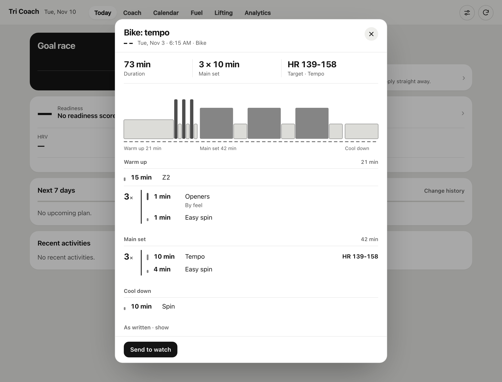
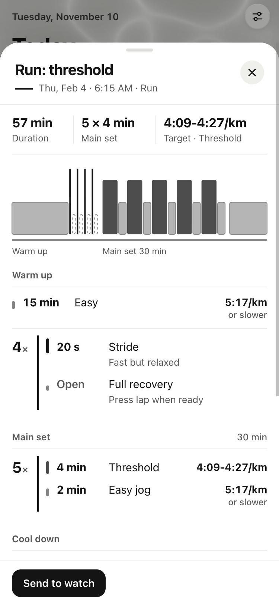
</p>

Run sessions are tidied as they are read, so the card and the watch always agree. A warm-up or cool-down written at the same pace as the block beside it is joined into one continuous block, and a walk recovery between reps becomes an easy jog. Coach Steve is told both rules too, so he stops writing sessions that way.

Swim drills are structured the same way. A drill set is never a bare `6×50 drill`: each drill is its own 100, 50 of the drill then 50 of swimming that keeps the skill, with a one-line cue. The rotation is 6-second switch, fingertip drag, catch-up and 3-point touch (`app/swim_drills.py`). The technique swim does all four, the endurance swim does two and alternates the pair each week, and any older or Coach-written `N×50 drill` is broken up into the same 100s when it is read. On the watch each 100 is its own step, named for its drill.

**Garmin's official API where it exists.** Garmin opened a Personal API in
October 2026: free, read-only, your own data, authenticated with a key you
create in Garmin Connect. With `GARMIN_PERSONAL_API_KEY` set, sleep, HRV, Body
Battery, resting heart rate, stress, SpO2, daily totals, heart-rate zones,
weight and the activity list are read from it. It does not publish Training
Readiness, Training Status, VO2max, lactate threshold, FTP, race predictions or
per-activity splits, and it cannot write, so those reads and Send to watch stay
on `garminconnect`. Every official read falls back to `garminconnect` if it
fails, and `/api/health` shows which source served each one. Without a key
nothing changes.

**Completion that respects intent.** A stretch class syncing from Garmin as
`strength_training` will not tick off a planned strength lift; mobility work is
classified separately.

**Per-activity deep dive.** Route, splits, HR/power/pace series, aerobic
decoupling (Pw:HR or Pa:HR, first half versus second) and a best-effort curve
from 5 s to 60 min, plus a cached AI read of the session.

**It reaches out when something changes.** Web-push notifications cover the
things worth a heads-up: a big brick tomorrow ("carb up tonight") or a
low-recovery morning. Coach briefs are fingerprinted to new sleep, workout-sync
or completion data, so simply reopening the app never creates another update.

---

## Architecture

A FastAPI backend serving a single-file vanilla-JS PWA. No frontend framework —
the whole UI is one hand-written `index.html` (SVG rings, the calendar grid and
pointer-based placement) so the app stays dependency-light and instant to load.

```
app/
  main.py            FastAPI app, routes, auth gate, background sync
  config.py          env + race-phase math; timezone-correct "today"
  db.py              SQLite (schema, migrations, plan/completions/constraints)

  strength_context.py  merges Garmin session evidence with Hevy weight evidence
  strength_weights.py  lb/kg snapping, increment inference, anchor-derived weights
  strength_effort.py   today's lifting ceiling: run load first, recovery may lower it
  strength_block.py    places a repeating upper/lower block around the key runs
  strength_visual.py   movement-pattern classifier + illustrated chat card view

  garmin_source.py   Garmin ingestion: readiness, HRV, sleep, activities,
                     training load / ACWR, VO2 & FTP, race predictions
  garmin_personal.py Garmin's official Personal API (key -> 24 h token, reads)
                     and the hybrid client that falls back to garminconnect
  fitness_age.py     Garmin's fitness age, or a labelled VO2max estimate when
                     Garmin has none; places VO2max on the Cooper bands
  rings.py           the four dashboard rings
  swim_drills.py     swim drill sets as 100s (50 drill / 50 swim), and the read-time tidy
  ring_detail.py     per-ring drill-downs (contributors, stages, charts)
  activity_detail.py per-activity deep dive + cached AI analysis
  interval_analysis.py recorded work bouts + duration-weighted HR execution

  zones.py           the athlete's REAL Garmin HR zones (per sport), LT, FTP
  plan.py            periodized plan generator (build / peak / taper), dispatching
                     to the builder the active event mode actually has
  marathon_plan.py   compressed marathon build: the long run carries the specific
                     adaptation, the bike carries aerobic volume
  half_iron_plan.py  seven-month 70.3 build (recovery → base → build → specific →
                     peak → taper) with three full-body lifts a week attached;
                     race-effort sessions carry paces derived from the goal split
  plan_adapt.py      closed-loop adaptation (session feedback, illness/travel reflow)
  suggest.py         today's session = plan + readiness advisory
  schedule_time.py   default workout times around the daily school block
  garmin_workout.py  push structured workouts to the watch
  workout_view.py    the workout sheet's view of those same steps: phases,
                     repeats, one target per row, a level per step for the chart

  coach.py           "Coach Steve" agent (chat, event briefs, private memory)
  coaching_contract.py fixed athlete/rules blocks + the one swappable event profile
  triathlon_knowledge.py reviewed pro reference (14 topics) and the night-out
                     call, worked out from the race date and the stored plan
  hevy_connector.py  official Hevy REST reads (retried on blips) + single-attempt writes
  hevy_actions.py    exercise resolution, weight provenance, non-retrying creates
  hevy_exercises.py  full-catalogue matching + confirmed custom-template creation
  calendar_agent.py  natural-language calendar assistant
  nutrition.py       daily targets + transport-ceiling intra-session fuelling

  calendar_source.py Google Calendar API (read + write, tagged events)
  calendar_sync.py   two-way sync engine (reconcile, reverse-pull, placement)

  push.py            web-push notifications
  insights.py        proactive signals    baselines.py  personal baselines
static/index.html    the entire front end (PWA)
```

**Data flow.** Garmin → normalized activity/readiness models → rings + plan +
readiness advisory → dashboard and today's session. The plan is the source of
truth; the calendar layer projects it onto real time and keeps Google in sync in
both directions.

---

## Design decisions worth calling out

A few problems here were more interesting than they first look:

- **The model's output is untrusted input.** The coach writes the training plan,
  and the app renders it. That makes every generated title and workout description
  attacker-reachable the moment the model reads something it didn't author — a web
  search result, a pasted race guide. Since the API token lives in `localStorage`
  and a generated week persists and re-renders in a later session, an unescaped
  title is stored token exfiltration, not a cosmetic bug. Three layers keep them
  apart: every model-derived field is escaped at the render site, the escape helper
  handles quotes as well as angle brackets (`textContent` does not, and one sink
  interpolates into a `class` attribute), and the server refuses markup outright so
  a payload never reaches storage for some future render path to find. Quotes are
  deliberately still allowed through the server guard — `5' rest` and `3" spacing`
  are ordinary training text, and escaping at the sink is what makes them harmless.

- **Identity is server-owned.** An event's persistence namespace decides which
  plans, drafts and chat history it can see. That namespace is derived server-side
  from a hash of everything that makes the event what it is — name, date, distances,
  goal, mode — and never from an id the model supplied. Two races on the same day
  with the same name but different distances are different events and get different
  namespaces; re-confirming the same event resolves to the same one, so a plan is
  never orphaned by a repeated confirmation.

- **A coach that knows where its competence ends.** The app carries a
  physiotherapy and strength-coaching reference — the pain-monitoring traffic light,
  tissue adaptation timelines, per-region exercise substitutions — so advice about a
  sore shoulder follows a consistent standard instead of whatever a general model
  recalls. The important half is what it refuses: it never names a diagnosis. "This
  movement aggravates it, here is one that does not" is a training decision; "you have
  impingement" is a clinical judgement, and acting on a wrong one is how somebody
  trains through a stress fracture. It carries explicit referral triggers for exactly
  that reason.

- **An injury constraint belongs in code, not a prompt.** The athlete has a bad
  shoulder: at most one pressing movement per session, no face pulls, and no muscle
  group worked twice in a row. A model told this in a system prompt will follow it
  most of the time, and "most of the time" is the wrong reliability target for
  something that can hurt someone. The rules are a module the generator is checked
  against, so a session that breaks them cannot be proposed — and logged history is
  checked against them too, which surfaced real past sessions built around a banned
  movement. Two cases were worth getting right: a chest fly is push but is *not* a
  press, and treating it as one rejected sessions the athlete deliberately builds.
  And an early version also banned triceps work on a pressing day, having read a
  remark about triceps as a second rule when it was emphasis on the first —
  over-constraining is its own failure mode, and it took the athlete correcting it
  to notice. Rules like these are worth reading back to the person before encoding.
  The last correction went further: the coach refused a session the athlete asked
  for by name (two presses) and kept refusing after "just run the one I told you".
  The rules now shape what the coach designs on its own; an explicit request from
  the athlete is built exactly as asked, without a warning. It's his shoulder.

- **"Not found" usually means "looked in the wrong place".** The coach kept
  reporting that ordinary exercises had no Hevy template and quietly shipping a
  three-exercise workout instead of six. All of them existed; it was searching the
  athlete's recent history rather than the full catalogue. Matching is now ranked —
  exact title, then ignoring the equipment qualifier, then requiring every requested
  word — and, crucially, variants the athlete has actually used win ties. Without
  that last rule "Squat" resolves to *Squat (Band)*. Anything genuinely missing is
  created through the API rather than dropped.

- **Two sessions are not a brick.** The plan's primary endurance session and a
  same-day lift are persisted separately and activated in one transaction. Each
  receives its own title, duration, structure and clickable detail. Generated
  `brick` rows are rejected unless they contain an explicit run-off-bike leg,
  and the browser defensively repairs the label on legacy malformed rows.

- **Two sources that each hold half the truth.** Garmin records *that* a strength
  session happened — duration, heart rate — and never which exercises or weights.
  Hevy records exercises, sets and exact weights, but only for sessions logged
  there. Reading either alone produces a confident wrong answer: for a stretch of
  this athlete's training, Hevy said "no lifting since June" while Garmin plainly
  showed six sessions through July. The app keeps both, dates each one, and treats
  weight evidence being older than session evidence as the signal that a block must
  start by calibrating rather than by prescribing stale loads.

- **A working weight is never invented.** A model that guesses a squat weight is
  guessing with someone's back. Every prescribed weight is either an exact value
  from Hevy history or a bounded derivation from one — a declared percentage
  (60–105%) of a specific set on a specific date — and the server re-verifies the
  anchor against freshly fetched history before any write. Two checks run
  independently: the anchor must exist, *and* the number must match its own stated
  derivation, so a routine can never display "85% deload" while writing the full
  load.

- **Pounds, not the stored kilograms.** Hevy stores every weight in kg as a float,
  so a 135 lb squat reads back as `61.235042773811365`. Showing that is wrong twice:
  the precision is fictional and the unit isn't the one on the bar. Weights snap
  back to the logged value, and the loadable increment is inferred per exercise from
  its own history — so a selection stack that only ever produced 192, 332 and 392 lb
  gets a real pin position rather than an arithmetically tidy number it cannot make.

- **Timezone-correct "today."** The server runs UTC on Fly; the athlete lives in
  Pacific. "Today" is resolved in the athlete's local zone everywhere, so the day
  rolls over at local midnight — not when UTC ticks over in the evening. A
  late-night bug where the app showed *tomorrow's* plan traced straight to this.

- **Idempotent calendar reconcile.** The sync guarantees exactly one Google event
  per training day. Events are tagged with private metadata so the app only ever
  touches its own, and each reconcile prunes any duplicate or orphaned copy —
  which matters once more than one instance can write to the same calendar.

- **Most-recent-wins reverse sync.** A workout's time can be edited on either side
  (dragged in the app or in Google), so the app tracks *when the position last
  changed* — separately from internal bookkeeping writes — and compares that
  against Google's `updated` timestamp so neither side clobbers a newer edit.

- **Latency budgeting.** The calendar assistant runs on a small fast model for
  structured parsing, and edits push only the single day that changed instead of
  re-syncing the whole week — turning multi-second commands into sub-second ones.

- **Placement is not prescription.** Calendar and Google Calendar can move a
  workout's date or start time, but they cannot silently rewrite its duration or
  contents. Those training decisions go through Coach Steve, where the full plan,
  recovery state and race phase are available.

- **Fresh screen, persistent context.** Every Coach visit starts as a clean
  visible conversation. Previous turns and dated durable memories stay private
  on the server and are still supplied to Steve, so there is no chat-history
  trawl and no loss of coaching continuity.

- **Garmin weight, explicit fallback.** The latest dated athlete-maintained Garmin
  weight entry feeds weight-dependent math as self-reported via Garmin. Its date
  and source travel with the number; missing data
  falls back to the labelled 86 kg self-report rather than a plausible estimate.

- **Hevy without fake connectivity.** The deployed app verifies its own Hevy Pro
  API credential and reports the real connection state. Lifting questions keep
  missing loads unknown. Routine proposals are read-only; only the athlete's Send
  action may create a genuinely missing exercise template and then the routine.
  Additive writes are never blindly retried, and a partial template write is
  surfaced explicitly if the routine itself fails.

- **Glass where it earns its keep.** Blur is reserved for chrome that floats
  over content: the bar a large page title collapses into, the tab capsule with
  its sliding lens, the sticky Coach bar and the composer. Content panes are
  tinted and translucent but never blurred, which keeps scrolling cheap and
  text sharp. Sheets are solid. Text fades out under the floating pieces
  instead of showing through the gaps around them, and all of it is safe-area
  aware.

- **A background that moves, and can be told to stop.** One small WebGL
  fragment shader draws a greyscale field behind the whole app: caustic light
  for a swim day, stretched streaks of wind for a ride, slow cloud for a run or
  a rest day. It renders at under half resolution and 30 frames a second, is
  dithered against banding, pauses when the page is hidden, and recovers from a
  lost graphics context. The canvas is never faded or transformed in CSS, which
  iPhone Safari punishes; all movement happens in the shader. Moving content
  needs a way to stop it, so the header opens Settings: appearance (Light,
  Dark), background (Auto, Water, Wind, Cloud, Plain), motion (Moving, Still)
  and panels (Glass, Solid). Light is the default whatever the system is set
  to; dark is a choice, applied before first paint and kept on the device.
  Reduce Motion holds a still frame. Reduce Transparency and Increase Contrast
  land on the same opaque token set as the Solid switch, because Safari does not
  report Reduce Transparency to a page. Tests compute text contrast from the
  tokens against the lightest and darkest point of the field in both themes.

- **Sport identity without colour.** The palette is monochrome, so the three
  sports are told apart by line: a wave for the swim, dashes for the bike, a
  solid line for the run. The same three lines draw the course on the Home bib
  from the goal splits and fill the weekly rows of the Training volume card.

- **An estimate is labelled as one, and kept out of the measured field.**
  Garmin gives no fitness age below 20. The athlete wanted a number anyway, so
  the API returns Garmin's `fitness_age` untouched (empty here) and a separate
  `estimate` object carrying the method, the VO2max it was read from and a flag
  saying the scale has hit its floor. The card reads "Estimated from VO2max".
  The day Garmin returns a number, the estimate disappears.

- **The call is computed; the sentence is written.** Whether a night out is
  fine is a question about dates, so it is answered in code: days to the race,
  the phase of the block, and whether the next morning is a key session. The
  model is handed the verdict and writes only the reply. Tests pin the boundary:
  14 days out is a no, 15 is a yes kept light. A night that cannot be dated
  gets a question back, never a guess.

- **A half-answered read is not cached like a whole one.** Fitness age needs
  two Garmin reads. When one fails, the result is kept for 60 seconds, not five
  minutes, and the response says which read answered (`reads`). Every derived
  number carries a provenance tag, so the estimate and the VO2max rating can
  never be mistaken for something Garmin measured.

- **Escaping and tidying are two different jobs.** `plain()` only tidies
  punctuation for display. `show()` escapes first and then tidies, and plan
  titles, workout notes and third-party strings reach the page through it.
  Tests pin the title sinks so a new render path cannot skip the escape.

- **A short marathon block is not a scaled-down long one.** Arriving with a big
  cycling base and an 8.5 km longest run, the obvious move is to ramp weekly
  kilometres. That is the move that breaks people: weekly volume can only rise so
  fast, and the one adaptation a marathon actually demands — tolerating hours of
  eccentric loading — is trained by the long run alone. Cycling is concentric and
  buys none of it. So the long run carries the specific progression and the bike
  carries aerobic volume. The ladder is anchored to race day rather than to the
  day the plan was generated, which is what lets the plan be regenerated
  mid-block without silently rewriting long runs the athlete has already seen.

- **A 70.3 straight after a marathon starts with recovery, not base.** The
  block opens with two weeks of swimming and easy spinning (no running at all in
  the first week, no lifting either), then counts every phase boundary back from
  race day in whole weeks. A recovery week falls every fourth week of base and
  build, with one full rest day. The swim — the weakest leg — keeps three
  sessions a week in every phase, and the lifts sit on those swim days because
  swimming barely touches the legs.

- **The lifting placer optimised the wrong thing, and only one event exposed it.**
  Sessions were spread for maximum spacing, with day "freedom" used merely to
  choose which slot got legs. In a triathlon week — rest days, swim days — the
  free days were also the well-spaced ones and it looked correct. A marathon week
  is running every single day, nothing scores highly, and spacing alone put a leg
  session on the long run every week and a lift on race day itself. Freedom now
  selects the candidate pool and spacing only breaks ties among days that cost
  the same, and race day is unusable at any price.

- **A valid routine can still render as "Exercise 2".** Once an exercise
  resolves to a Hevy template id, the API payload carries only the id, and the
  chat card named it from recent workout history. Any movement never logged
  before showed as a numbered placeholder, and after a restart every exercise
  did. The card now names exercises from the resolver's matched title and the
  cached catalogue first, so it shows the name Hevy will actually save.

- **Classification that respects intent.** A Peloton stretch syncs from Garmin as
  `strength_training`; counting it as a completed strength lift is wrong, so
  mobility/yoga/stretch work is reclassified to its own category and never
  completes a strength session.

---

## Tech stack

Python · FastAPI · SQLite · Garmin Connect Personal API ·
[garminconnect](https://github.com/cyberjunky/python-garminconnect) · Anthropic Claude API · Hevy API · Google Calendar API · Web Push (VAPID) · vanilla
JS/HTML/CSS PWA · Docker · Fly.io.

---

## Running it locally

Requires Python 3.10+ and a Garmin account. The AI features need an Anthropic API
key; the calendar features need a Google Cloud OAuth client. Both degrade
gracefully — the dashboard works without them.

```bash
python3 -m venv .venv && source .venv/bin/activate
pip install -r requirements.txt

cp .env.example .env      # then fill in keys and optional athlete details
python -m app.main        # serves http://127.0.0.1:8770
```

The Garmin Personal API key is optional. Create it yourself in Garmin Connect
(Settings, Personal API token), put it in `.env` as `GARMIN_PERSONAL_API_KEY`,
and replace it before the expiry you chose (30 days to 1 year). The Garmin
email and password are still needed for the reads and writes the official API
does not cover.

`.env.example` documents every setting. Secrets (`.env`, the SQLite DB, and the
Google `credentials.json` / `token.json`) live under `data/` and are gitignored —
nothing sensitive is in the repository.

### Google Calendar (optional)

1. In Google Cloud Console, enable the Calendar API and create an **OAuth client
   ID → Desktop app**; download the JSON to `data/credentials.json`.
2. Add your own address as a Test user on the OAuth consent screen.
3. First run opens a browser once to authorize; the token caches to
   `data/token.json` and refreshes itself after that.

### Deployment

Containerized with the included `Dockerfile` and deployed on Fly.io
(`fly.toml`), with a persistent volume for the SQLite DB and cached credentials.
The machine scales to zero and wakes on request. Keys are Fly secrets, never
files in the image: `fly secrets set GARMIN_PERSONAL_API_KEY=...`.

---

## Built with AI, deliberately

This was built with AI coding tools doing most of the typing — **Claude Code** and
**OpenAI Codex**, used side by side. That is not a disclaimer, it is the method.

What I brought was the part that actually determines whether a system like this
works: deciding what it should do, how the data model should be shaped, and where
it was wrong. A few examples of that line in practice, all of which are in the
commit history:

- The readiness engine originally *replaced* my planned session when HRV looked
  low. It swapped a key VO2 workout for a recovery spin, I saw the easy session
  and went back to bed, and the numbers turned out to be fine. I had it rewritten
  so readiness advises and the athlete decides. That is a product judgement, not a
  code change.
- The calendar sync quietly accumulated duplicate events because reconciliation
  only pruned events on *unsynced* days. Diagnosing that took reading the sync
  logic against the Google API's actual behaviour, then making the reconcile
  idempotent by construction.
- The block counter read "Wk 5 of 8" beside "9 days out" — two derivations of the
  same fact that could drift apart. It now derives from a single source so the two
  cannot contradict.
- Fuelling was a flat carbohydrate target until I specified it against intestinal
  transport limits, because I have a documented GI failure from overfuelling
  glucose. Now it caps glucose at 60 g/h, holds a 2:1 ratio above that, and shows
  its arithmetic so I can check it.

Working this way well is a skill: knowing what to ask for, catching the plausible-
looking answer that is wrong, and keeping architectural coherence across a system
one person could not otherwise have shipped on nights and weekends. That is the
part worth showing.

## License

MIT — see [LICENSE](LICENSE).
